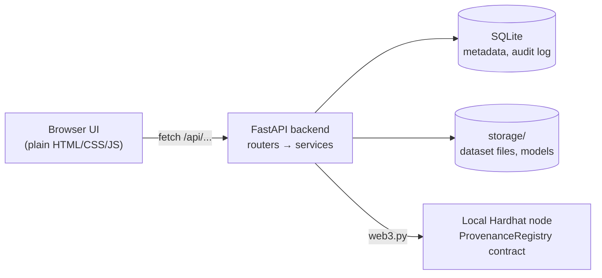

# How DataOrigin is built

DataOrigin answers one question for a dataset or an ML result: *can we prove where this came from, and that nobody changed it since?*

To do that, it does four things:
- keeps every version of a dataset as an immutable, hashed file
- records how each version was derived from the one before
- ties experiments to the exact data and configuration they used
- anchors the important hashes on a blockchain, so they can be checked later

This page explains how the pieces fit together. For setup and the demo script, see the [README](../README.md).

## The big picture



It is one Python process. The backend serves the API under `/api` and the static frontend at `/`, so there's nothing else to deploy. The chain is optional: when it's off or unreachable, DataOrigin still works and verifies against local hashes only.

## Repository layout

```
backend/
  app/
    main.py          app factory: wires routers, error handlers, static files, startup
    config.py        settings from defaults < backend/.env < environment
    db.py, models.py SQLAlchemy setup and the seven tables
    schemas.py       response/request shapes (Pydantic)
    routers/         thin HTTP layer, one file per area
    services/        all the actual logic (see below)
  scripts/seed_demo.py   builds a ready-made demo story
  tests/             pytest suite, one file per feature area, plus sample data in tests/data/
contracts/
  contracts/ProvenanceRegistry.sol   the on-chain registry
  scripts/deploy.js                  deploys it and tells the backend where it is
  test/                              contract tests (Hardhat + Mocha)
frontend/
  index.html, css/style.css          app shell and both themes (light glass, dark console)
  js/app.js                          hash router (#/datasets/3 and so on)
  js/api.js                          fetch wrapper with error toasts
  js/components/                     small reusable pieces: DOM helper, tables, tabs, charts
  js/pages/                          one module per screen
docs/structure.md    this file
```

## Backend

Routers only deal with HTTP: they parse the request, call a service, and shape the response. Everything else lives in `app/services/`.

| Service | What it does |
|---|---|
| `loader.py` | Reads CSV, XLSX and JSON into a DataFrame and rejects broken files (blank or duplicate headers, empty data). |
| `storage.py` | Writes each version to `storage/datasets/{id}/v{n}.{ext}`. It opens files in exclusive mode, so an existing file can never be overwritten. |
| `versions.py` | Creates a version: saves the file, hashes it, records the parent and the transformation, runs a quality report, and writes an audit event. |
| `quality.py` | Missing values, duplicates, IQR outliers, constant columns, IsolationForest anomalies, a 0–100 score, and plain-English findings that suggest a fix. |
| `drift.py` | Compares two versions column by column (PSI) and reports schema changes. |
| `transforms.py` | A small whitelist of cleaning operations (drop duplicates, fill missing values, filter rows, …). Each run produces a new version. |
| `lineage.py` | Builds the version/experiment graph and works out what is downstream of any version. |
| `ml.py` | Trains one of four scikit-learn models with a fixed seed. It records metrics and the environment, and computes the experiment's *commitment hash*. |
| `chain.py` | Talks to the contract: register, retry, verify, and detect chain resets. |
| `report.py` | The audit report (JSON or printable HTML) and the reproducibility score. |
| `audit.py` | The hash-chained audit log. |

### Data model

Seven tables:
- **`datasets`** and **`dataset_versions`**: one row per immutable file, with its SHA-256, size, shape, schema and parent version.
- **`transformations`**: links each derived version to its parent, with the operations that were applied.
- **`quality_reports`**: one or more reports per version.
- **`experiments`**: configuration, seed, metrics, environment, model hash and commitment hash. A reproduction links back to the run it reproduced.
- **`chain_records`**: one row per registration attempt, with its status (`registered`, `pending` or `failed`) and the transaction details.
- **`audit_events`**: the tamper-evident log.

Timestamps are stored as ISO strings rather than database datetimes, so a hash computed over them is exactly reproducible.

## How the main flows work

**Uploading data.** The file is validated, hashed and stored as v1 of a new dataset. A quality report runs immediately.

**Cleaning data.** You pick operations in the UI, often straight from a quality finding ("fill missing `age` with the median"). The backend applies them in order and saves the result as a new CSV version, with the input as its parent. The original is never touched.

**Running an experiment.** The run is tied to one exact version. Before training, the backend checks that the stored file still matches its hash. After training it computes a commitment:

```
sha256( dataset hash + version + task + algorithm + target + hyperparameters + seed + test size + metrics + environment )
```

The commitment is what goes on chain, rather than the model file, because saved model files aren't byte-for-byte reproducible. **Reproduce** re-runs the same configuration and compares metrics within 1e-9.

**Registering and verifying.** Register sends the hash to the contract. If the node is down, the record is saved as `pending` and retried later. Verify recomputes the hash and compares it with the database and the chain:

| Verdict | Meaning |
|---|---|
| **VERIFIED** | The file matches its recorded hash, and that hash is on chain. |
| **LOCAL_ONLY** | The file matches, but the chain record is pending, the chain is unavailable, or the chain was reset. |
| **TAMPERED** | The file (or the experiment's recomputed commitment) no longer matches what was recorded. |
| **NOT_REGISTERED** | The file matches, but the artifact was never registered. |

**Chain resets.** The local Hardhat node keeps everything in memory, so restarting it wipes its records. Redeploying puts the contract back at the same address. DataOrigin recognises the reset because the registration *transaction* is gone too; the contract can't delete records any other way. It reports LOCAL_ONLY instead of TAMPERED, and re-registers the lost records when the backend starts or when you click *Retry pending*.

**The audit log.** Every change writes an event whose hash covers the previous event's hash:

```
event_hash = sha256(prev_hash + type + entity + id + payload + timestamp)
```

Editing any past event breaks every hash after it, and *Verify log integrity* finds the first broken link.

## The smart contract

`ProvenanceRegistry.sol` is deliberately tiny. It maps a 32-byte hash to who registered it, when, and for which artifact. Registering the same hash twice reverts, and nothing can be updated or deleted. That append-only property is what makes the on-chain timestamp meaningful.

## Frontend

The frontend is plain ES modules, with no framework, no build step and no npm packages. Each page is a module that exports `render()`, and `app.js` picks the page from the URL hash. The page-building helper `h()` only ever creates text nodes, so data from the API is always escaped.

There are two themes, and all colours, radii and effects come from CSS variables:
- **Light** is "Liquid Glass": frosted panels over slowly drifting cool-tone shapes.
- **Dark** is a flat "research console": a deep teal-black background, solid bordered cards, a mint accent, and icons in the sidebar.

The theme follows your system setting until you toggle it, and the choice is remembered. Charts and the lineage graph are hand-written SVG. Animations, such as the TAMPERED pulse and the flowing lineage edges, switch off for people who prefer reduced motion.

## Testing

- `backend/tests/`: about 110 pytest tests covering every endpoint and flow, using a temporary database and storage. The on-chain tests are marked `chain` and skip automatically when no node is running.

  | File | Covers |
  |---|---|
  | `test_app.py` | health check, static frontend, unknown routes |
  | `test_datasets.py` | uploads, hashing, versions, preview/download, local verify, audit log |
  | `test_quality_drift.py` | quality analysis and scoring, drift between versions |
  | `test_transforms_lineage.py` | cleaning operations, lineage graph, downstream impact |
  | `test_experiments.py` | training, reproduce, compare, failure handling |
  | `test_chain.py` | registration, verification verdicts, chain-down fallback, chain resets |
  | `test_reports.py` | audit report (JSON and HTML), reproducibility score |
  | `test_frontend_assets.py` | every JS file passes `node --check`, assets served with the right types |
  | `test_frontend_pages.py` | page modules, dashboard/theme, quiet verify, lineage rendering guard |
  | `test_seed_demo.py` | the demo seed script builds the full story |
- `contracts/test/`: contract behaviour (register, duplicate revert, record lookup).
- The pytest suite also runs `node --check` on every frontend file and checks that the static assets are served with the right types.

## Trade-offs worth knowing

- **One process, SQLite, local files.** This keeps setup to minutes and suits a single user. All database access is dialect-neutral, so moving to Postgres is a configuration change.
- **A local chain, not a public one.** It's free and instant for demos. The contract is network-agnostic: deploying to a public testnet would make the timestamps independently verifiable.
- **Training runs inside the request.** That's fine for the small predefined models here; real workloads would want a job queue.
